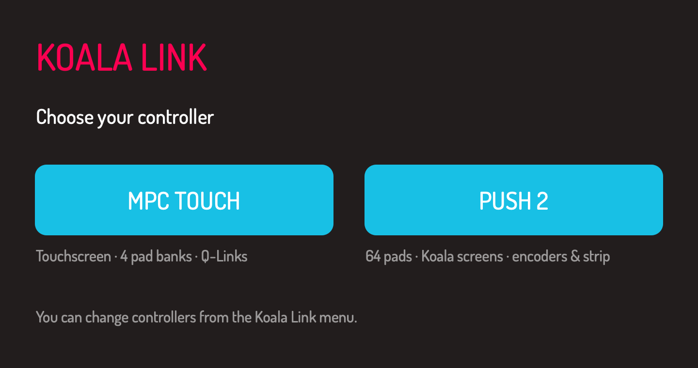

# Koala Link

Use Koala Sampler with an Akai MPC Touch or Ableton Push 2. Koala Link is free
to download and use. The current release is **v1.4.7** (app version **1.4.7**,
build **19**). MPC Touch is supported; Push 2 remains a preview and is not
validated as a supported controller.

**[Download Koala Link v1.4.7](https://github.com/savilionmusic/koala-link/releases/tag/v1.4.7)** · [Manual (PDF)](https://github.com/savilionmusic/koala-link/releases/download/v1.4.7/Koala-Link-1.4.7-Manual.pdf) · [Push 2 controls](docs/PUSH2-CONTROLS.md) · [Push 2 validation notes](docs/PUSH2-RESEARCH.md)

The earlier **v1.4.6**, **v1.4.5-preview.1** and **v1.4.5** releases are
historical; the current public release is **v1.4.7**.



[Push screen previews](docs/screens/Koala-Link-Push-Screens.png) · [Complete Push controls](docs/PUSH2-CONTROLS.md)

## Requirements

- An Apple silicon Mac running macOS 13 or later, and Koala Sampler for Mac
  (required separately).
- For MPC Touch, DisplayLink Manager is also required separately; the installer
  includes the MPC Touch driver. For the Push 2 preview, connect
  the controller by USB. Close Ableton Live while Koala Link uses the Push
  display, and quit Paper Cut if it is using the Push.
- Webcam recording needs a camera and Camera plus Screen & System Audio
  Recording permission. macOS may ask for Open Anyway because the app is not
  notarized.

## Webcam recording in v1.4.7

Record yourself playing with Koala's sound, the pad you hit and its waveform
on screen. Choose 16:9 or 9:16 for Reels, TikTok and Shorts. The MP4 files
export at 1080×1920 in H.264 and AAC, ready to upload. See the
[Koala Link manual (PDF)](https://github.com/savilionmusic/koala-link/releases/download/v1.4.7/Koala-Link-1.4.7-Manual.pdf)
for setup and recording details.

## Install

1. Download **Koala-Link-1.4.7-Installer.pkg** from Releases and run it.
2. Open Koala Link from Applications and choose your controller. Connect and
   power the Push 2 before choosing it; connect the MPC Touch before choosing it.
3. On a new Koala installation, Koala Link opens Koala once to create its settings.
   Complete any welcome or permission dialogs, then quit Koala when asked.
   Koala Link prepares the selected controller's MIDI mappings and reopens
   Koala. If setup could not finish, complete Koala's first-time setup, quit
   Koala, and choose your controller again.
4. For MPC Touch, allow **Koala Link** and **mpc_touchd** in System Settings
   → Privacy & Security → Accessibility when prompted.

Koala Link replaces Koala Touch and retains its settings paths for upgrades. Existing Koala preferences and MIDI maps are backed up before controller setup changes them.

The app and installer use ad-hoc signing and are not notarized. If macOS blocks
the download, use the Open Anyway control in Privacy & Security.

## MPC Touch controls

Koala fills the MPC screen. The four pad banks provide 64 sample pads;
Q-Links, FULL LEVEL, 16 LEVELS, REC and PLAY control Koala. Quitting Koala
also quits Koala Link.

Press **FULL LEVEL** to toggle maximum pad velocity. With its light on, every
physical pad strike sends velocity 127; with it off, strikes keep their measured
velocity. This works across banks A–D in sample and Chopper modes. Koala Link
enables Koala's MIDI and keyboard velocity settings for this control. FULL LEVEL
starts off when Koala Link opens, and retains its state through an MPC reconnect.

Press **16 LEVELS** to enter Chopper keyboard mode. Physical bank A pad 1
plays **chop 1**. Notes 60–123 address the first 64 chops in order, regardless
of the sample's chop count, on channel 16:

| Pad bank | Chops with at least 64 slices | MIDI notes |
| --- | --- | --- |
| A | 1–16 | 60–75 |
| B | 17–32 | 76–91 |
| C | 33–48 | 92–107 |
| D | 49–64 | 108–123 |

The first note is the bottom-left physical pad, with notes increasing across
each row from bottom to top. Bank changes address more chops in the selected
sample. Entering Chopper mode starts at bank A; leaving restores the previous
sample bank and sample-pad notes 36–99. The Chopper's own chop count and
**CHOP: NOTE** setting control how it responds to the notes. With fewer chops,
Koala wraps notes across the available slices, including smaller and odd chop
counts. C−1 is not the first chop. With 128 chops, these four banks still play
chops 1–64. Reaching chops 65–128 would require another page, with the MIDI
note ceiling handled and the behavior confirmed live in Koala; that is not
part of the MPC mapping described here.

Koala Link follows the keyboard state in Koala's restored song and native
Sequence keyboard-button taps, as well as the physical **16 LEVELS** button.
Held notes keep their original assignment until release, even if the bank or
mode changes.

The sample-pad map is maintained automatically at launch with backups. Koala's
MIDI Learn also hears the hardware's raw port, so learning these same controls
by hand can replace the translated mapping. Quit and reopen Koala Link to
restore its assignments. Q-Link bank A is mapped to start, length, volume and
pitch. Banks B–D expose CC5–16 on channel 15 for custom MIDI Learn assignments.
See [MIDI mapping](docs/MIDI-MAPPING.md) for the physical pad table and routing details.

The touchscreen driver supports steady holds, drag-to-trash and two-finger
zoom in the sample editor and piano roll. The installer sets pinch gain to
500. A 1024×640 MPC display mode made small Koala controls easier to touch on
the development setup; the driver follows the screen's current resolution.

Preview the Push screens offline (no controller or MIDI endpoints are opened):

```sh
"build/Koala Link.app/Contents/MacOS/KoalaTouch" --render-push /tmp/koala-link-screens
```

## Build

The **v1.4.6** release (previous version, app build 18) included
cached fast waveform display and sample-pad selection, local trim feedback,
and local sequence and piano-roll previews. Timing and sequence previews use
Koala clock when available and reconcile with saved files; native autosave can
delay confirmation. Delete targets one loaded sample pad at a time, retains
Koala's native confirmation setting, and supports limited local Undo preview.
New gesture behavior still needs physical Push validation; not every control
has been verified on hardware.

Build 16 added preloaded Push
waveforms, immediate waveform selection on Push pad hits, and a display queue
that sends the newest frame as soon as the previous transfer finishes. The
normal sample-pad press selects that pad for Koala's editing controls and its
waveform immediately. Push sample pads use channel 16; keyboard/Chopper notes
use channel 13 with no pad mappings, keeping the source pinned. MPC Touch
retains its accepted channel-16 keyboard profile. Controller changes reopen
Koala normally when the MIDI settings differ. Mouse selections
and newly recorded/imported audio still depend on Koala saving its files.
Push START/LENGTH edits now move the waveform markers and highlighted trim
region directly from the sent MIDI commands. Encoder, touch-strip and recorded
macro edits share this path. Fresh saved values reconcile the display afterward;
older reads cannot pull back a more recent edit. START's effect on the other
boundary is learned from conclusive saved results for each Koala version.
The original **1.4.0-preview.1** (app 1.4.0, build 8) was the first Push
preview. The **v1.4.5-preview.1**, **v1.4.5**, and **v1.4.6** releases are
historical; the download link above points to **v1.4.7**. Push physical
validation remains pending.

Install Xcode Command Line Tools, then run:

```sh
./build-app.sh
./installer/build-installer.sh
```

The app is written to `build/Koala Link.app`; the installer is written to
`dist/Koala-Link-Installer.pkg`. Building does not install either one.

Push controls and current validation limits are in the
[Push 2 controls](docs/PUSH2-CONTROLS.md) and
[Push 2 research](docs/PUSH2-RESEARCH.md) notes.

`TouchDriver/` contains the driver source and the accepted signed binaries
used by the app. App builds copy those binaries without re-signing them.
Rebuilding the driver with `TouchDriver/build.sh` changes its ad-hoc signature
and requires another Accessibility approval after installation.

## Remove

Run `/Library/Application Support/Koala Touch/uninstall.sh`. The touchscreen
service is shared with Paper Cut, and is retained when Paper Cut is installed.

## Credits

Created by Savilion. Alicja Hand font credit: copyright 2026 Alicja Gajewski,
included with the publisher's redistribution permission. See [NOTICE.md](NOTICE.md).

Koala Link is an independent companion app for Koala Sampler and supported controllers.

## More controllers

The controller picker keeps the MPC and Push sessions separate. See the
[Push 2 control reference](docs/PUSH2-CONTROLS.md) and
[implementation and validation status](docs/PUSH2-RESEARCH.md).
